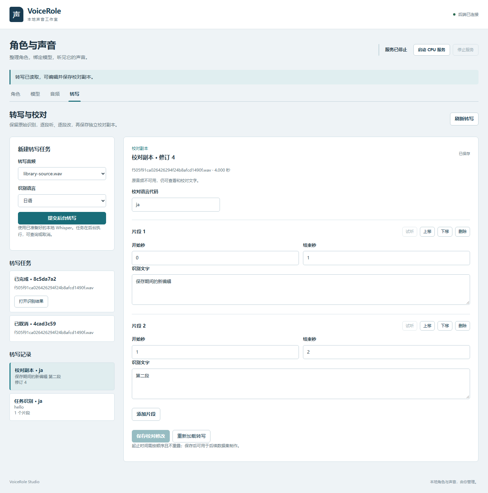
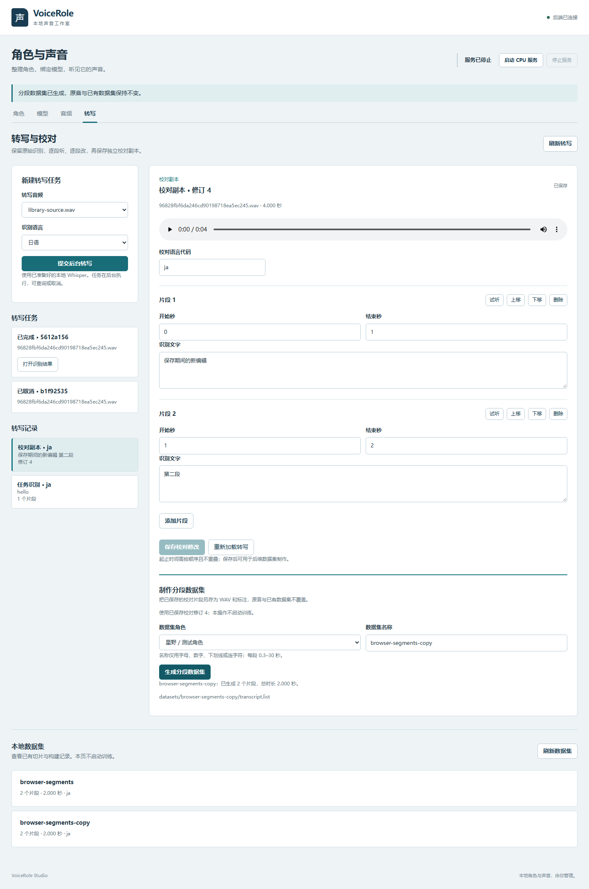

# VoiceRoleChat-Studio

本地优先的 AI 角色语音工作室：围绕角色配置、音频转写、声音训练和模型管理，逐步实现支持多语言字幕与角色声音的对话体验。

**当前处于开发阶段。** 中文工作台已接入角色编辑、模型管理、声音绑定和试听 API，并通过真实浏览器流程测试。真实日语 CPU 合成已验证；LLM 对话和实时语音聊天尚未实现。

## 功能现状

| 模块 | 当前能力 | 验证边界 |
|---|---|---|
| 后端基础 | FastAPI、健康检查、OpenAPI | 已通过实际 Uvicorn HTTP 测试 |
| 角色 | 创建、编辑、版本化 JSON、声音绑定和按角色合成 | 已验证兼容旧记录、修订冲突、绑定和合成配置快照 |
| 音频库 | 上传、解码检查、原音试听、参考片段和录音预览/导入 | WAV/MP3 与 WebM 实际解码通过；录音浏览器测试使用合成麦克风 |
| 语音转写 | 离线 Whisper、持久任务、取消/超时/恢复、逐段校对副本 | Windows 日语 CPU HTTP 实测；中文任务与校对工作台通过隔离浏览器验证 |
| 数据集 | 从音频和转写生成 GPT-SoVITS 标注 | 已支持保存校对→逐段 WAV/标注、质量检查、不可覆盖发布 |
| 训练 | 持久队列、取消/超时/恢复、独立输入、轮数和批量配置 | 原生假流水线通过；真实 GPU 短训练未在预算内完成，尚无新模型试听验收 |
| 模型管理 | 权重配对、版本选择、导出发现、来源去重、ID 冲突处理 | 已有专项回归与真实列表/详情/刷新测试 |
| 推理服务管理 | 状态探测、自有进程启停、超时和正常退出清理 | 已验证真实 CPU 模型启动及清理 |
| 文本合成 | 模型权重串行选择、参考 WAV 校验、WAV 生成与读取 | 已用已有日语模型执行真实离线 CPU 合成；其他语言与长文本待验证 |
| LLM 接入 | 本机兼容服务配置、模型列表、固定提示连接检查 | 假 HTTP 协议/失败测试通过；本机未配置运行中的真实提供方 |
| 前端 | 中文角色/模型/音频/转写工作台、声音绑定、服务控制与试听 | 桌面/移动端浏览器验收通过；浏览器测试使用隔离数据和模拟推理 |
| 角色聊天 | LLM、会话历史、双语回复和语音播放 | 规划中 |

## 完整使用流程与开发路线

```text
环境检查 → 创建角色
             ├─ 选择已有模型 ───────────────────────┐
             └─ 上传音频 → 转写校对 → 数据集 → 训练 → 导出模型
                                                   ↓
                                   配置参考音频 → 合成试听 → 绑定角色
                                                   ↓
                           配置 LLM → 文字或录音输入 → 回复/翻译/播放
                                                   ↓
                                         会话保存、备份与导出
```

上图是目标流程，部分步骤仍待实现。详细的 **23 项任务、依赖和验收标准**见 [项目路线](docs/PROJECT-ROADMAP.md)。

- **M1：声音能用**——模型发现、环境配置、真实合成、角色绑定和最小前端。
- **M2：角色能聊**——LLM、会话历史、双语回复、按键录音和自动播放。
- **M3：工作室可发布**——训练工作台、流式打断、系统诊断、备份和首次启动引导。

## 环境要求

- 当前主要开发平台：Windows / PowerShell。
- Python **3.10 或更新版本**；已在 Python 3.10.20 和 3.12.8 的现有环境测试后端。
- 后端依赖见 [backend/requirements.txt](backend/requirements.txt)。
- 训练与推理需要单独准备 GPT-SoVITS、对应的依赖及模型权重；仅安装后端依赖不会完成这些步骤。
- 本仓库不附带声音样本、模型权重、Conda 环境或训练数据。

### 安装后端依赖

从仓库根目录执行：

```powershell
git clone https://github.com/zhengzhenghao007/VoiceRoleChat-Studio.git
cd VoiceRoleChat-Studio
python -m venv .venv
.\.venv\Scripts\python.exe -m pip install -r backend/requirements.txt
```

为避免 PowerShell 激活脚本策略的影响，示例直接使用虚拟环境解释器。
依赖当前没有锁定版本；上面的命令是安装步骤，不代表全新环境已完成验收。

### 启动后端

推荐从仓库根目录检查环境后启动：

```powershell
.\.venv\Scripts\python.exe run.py --check
.\.venv\Scripts\python.exe run.py --host 127.0.0.1 --port 8000
```

使用已有 Python 环境时，将 `.\.venv\Scripts\python.exe` 替换为对应解释器。也可从任意目录以绝对路径调用 `run.py`。
启动器会设置后端模块目录，默认绑定 `127.0.0.1:8000`。
直接使用 Uvicorn 时，仍可执行 `python -m uvicorn app:app --app-dir backend --host 127.0.0.1 --port 8000`。
正常启动会创建所需数据目录；`--check` 只读检查，不创建目录、不启动服务、不加载 ML 模块或下载模型。

自动化诊断使用 `python run.py --check --json`，stdout 为 JSON。退出码：`0` 表示必需检查通过（可含训练资源缺失告警），`1` 表示依赖或配置错误，`2` 表示命令行参数无效。依赖检查只证明模块可以发现；训练资源检查只核对路径及类型，不证明硬件或模型可用。

打开：

- 健康检查：[http://127.0.0.1:8000/health](http://127.0.0.1:8000/health)
- 声音工作台：[http://127.0.0.1:8000/studio/](http://127.0.0.1:8000/studio/)
- 交互式 API 文档：[http://127.0.0.1:8000/docs](http://127.0.0.1:8000/docs)
- OpenAPI：[http://127.0.0.1:8000/openapi.json](http://127.0.0.1:8000/openapi.json)

健康检查预期返回 `{"status":"healthy"}`。它仅表示业务服务可响应，不证明 GPU、Whisper 或 GPT-SoVITS 模型已加载。

### 使用声音工作台

后端启动后，直接打开 [声音工作台](http://127.0.0.1:8000/studio/)。前端由同一后端提供，无需额外安装 JavaScript 依赖、启动静态服务器或配置 API 地址。

1. 创建或选择角色，填写角色设定并保存。
2. 在“模型”页查看完整/不完整配对，选择用于当前角色的模型。
3. 上传一段 3–10 秒 PCM WAV，填入准确的参考文字和语言，保存声音绑定。上传不会自动保存角色。
4. 显式点击“启动 CPU 服务”，再生成短句试听。使用播放器播放或下载 WAV，完成后可停止服务。

未保存修改会阻止试听；切换角色前会提示是否放弃草稿。修订冲突和校验失败保留表单，重新加载角色需明确确认。失效的模型绑定不会被自动换掉或清空。
页面不会自动加载推理模型。外部未托管服务仅显示状态；聊天和完整训练界面留到后续任务。“对话偏好”目前只保存设置，不代表聊天功能已可用。

工作台截图（隔离测试数据）：


## GPT-SoVITS 与转写配置

项目默认在根目录的 `GPT-SoVITS/` 查找外部安装，目前仅支持 v2Pro 训练流程。
训练前必须自行准备兼容的上游环境和预训练文件。

| 路径（相对 `GPT-SoVITS/`） | 用途 |
|---|---|
| `GPT_SoVITS/pretrained_models/chinese-roberta-wwm-ext-large/` | BERT |
| `GPT_SoVITS/pretrained_models/chinese-hubert-base/` | HuBERT |
| `GPT_SoVITS/pretrained_models/sv/pretrained_eres2netv2w24s4ep4.ckpt` | 声纹权重 |
| `GPT_SoVITS/pretrained_models/v2Pro/s2Gv2Pro.pth` | SoVITS 生成器初始权重 |
| `GPT_SoVITS/pretrained_models/v2Pro/s2Dv2Pro.pth` | SoVITS 判别器初始权重 |
| `GPT_SoVITS/pretrained_models/s1v3.ckpt` | GPT 初始权重 |

配置通过启动后端之前设置的环境变量生效：

| 环境变量 | 默认值 / 约束 |
|---|---|
| `GPT_SOVITS_ROOT` | `<repo>/GPT-SoVITS`；工具、预训练资源和训练权重发现使用此目录 |
| `GPT_SOVITS_PYTHON` | 保留原开发机 Conda 回退路径；其他机器请显式配置 |
| `GPT_SOVITS_VERSION` | `v2Pro`；当前其他版本会返回明确配置错误 |
| `GPT_SOVITS_GPU` | `0`；当前仅支持单个 GPU 编号，检查不探测真实 GPU |
| `GPT_SOVITS_API_PORT` | `9880`；1–65535，固定使用本机回环地址 |
| `GPT_SOVITS_REQUEST_TIMEOUT` | `2` 秒；大于 0、最多 30 秒，单次探测总时限 |
| `GPT_SOVITS_START_TIMEOUT` | `120` 秒；大于 0、最多 600 秒，启动就绪等待时限 |
| `GPT_SOVITS_STOP_TIMEOUT` | `10` 秒；大于 0、最多 60 秒，停止等待总预算 |
| `GPT_SOVITS_SYNTHESIS_TIMEOUT` | `180` 秒；大于 0、最多 600 秒，状态验证、权重切换与合成共享期限 |
| `WHISPER_MODEL_SIZE` | `small`；模型名称或模型标识 |
| `WHISPER_DEVICE` | `cpu`；可选 `cpu`、`cuda`、`auto` |
| `WHISPER_COMPUTE_TYPE` | `int8`；如 `float32`、`float16`、`auto` 等受支持类型；硬件兼容性在实际加载时判断 |
| `WHISPER_JOB_TIMEOUT` | 后台转写运行截止时间，默认 300 秒，最大 3600 秒；不适用于旧同步接口 |

```powershell
$env:GPT_SOVITS_ROOT = 'D:\tools\GPT-SoVITS'
$env:GPT_SOVITS_PYTHON = 'C:\path\to\your\gpt-sovits\python.exe'
$env:WHISPER_MODEL_SIZE = 'small'
$env:WHISPER_DEVICE = 'cpu'
python run.py --check
```

在启动后端的同一终端设置。两个路径配置的相对值均以仓库根目录解析，与当前工作目录无关。空值、无效版本及无效设备配置会被拒绝。没有隐式加载 `.env` 文件。
角色、数据集、导出模型和任务数据仍保存在仓库内原有目录，不会随工具目录迁移。训练权重扫描跟随 `GPT_SOVITS_ROOT`，导出 manifest 扫描仍在项目的 `models/`。
其他参数见 [backend/config.py](backend/config.py)。真实转写仅使用本地模型；缺失时返回不可用，不隐式下载；仅启动后端和运行本仓库测试不会触发该模型加载。

## 推理服务启停

业务后端启动时不会自动启动 GPT-SoVITS。准备好上述外部解释器、`api_v2.py`、GPT/SoVITS 初始权重和 BERT/HuBERT 后，显式调用：

```powershell
Invoke-RestMethod http://127.0.0.1:8000/api/tts/service
Invoke-RestMethod -Method Post http://127.0.0.1:8000/api/tts/service/start
Invoke-RestMethod -Method Post http://127.0.0.1:8000/api/tts/service/stop
```

本轮以 CPU、`is_half=false`、v2Pro 启动上游服务，子进程设为离线模式，不主动获取缺失模型。
每次启动将独立配置和日志写入 `outputs/tts-service/<run-id>/`，不会改写上游 `tts_infer.yaml`。
资源文件存在并不保证其内容有效；启动失败时查看对应 `service.log`。

返回 `state`、`managed`、`pid`、`detail`。状态含义：`unavailable` 未就绪；`starting` 正在启动；`ready` 兼容接口可响应；`stopped` 已完成显式停止；`failed` 自有进程退出或启动/清理失败。
`ready` 仅验证 OpenAPI 的推理和权重切换路由，不验证服务身份、模型加载或合成质量。探测不发起合成。
手动启动的兼容服务显示 `managed=false`、`pid=null`；对任何外部监听服务请求启停都返回 409，工作室不会接管或结束它。
并发启停返回 409；缺文件或提前退出返回 503；启动或清理超时返回 504。停止时先终止，再在剩余预算内强制结束自有进程；清理失败保留句柄供重试。

**仅支持一个业务后端进程**，不要使用多个 Uvicorn worker 或同时运行多个工作室后端。
正常退出会清理自有子进程；强制结束后端、系统崩溃不保证清理。当前按上游单服务进程管理，不负责其自行派生的孙进程，也不会根据进程名或 PID 文件接管遗留进程。
合成接口只允许操作工作室托管的就绪服务；手动启动的外部服务仍保持只读检测。

### 文本合成与试听

先在 `/api/models` 选取 `ready` 模型，上传或准备一段 **3–10 秒 PCM WAV** 参考音频，并确认其对应文本。参考路径只能位于项目 `uploads/` 或 `datasets/` 中，不接受绝对路径或 `..`。

```powershell
Invoke-RestMethod -Method Post http://127.0.0.1:8000/api/tts/service/start
$request = @{
    model_id = '<从模型列表复制 ID>'
    text = 'こんにちは。'
    text_lang = 'ja'
    reference_audio = 'uploads/<已上传的参考音频>.wav'
    prompt_text = '<参考音频中的准确文本>'
    prompt_lang = 'ja'
} | ConvertTo-Json
$result = Invoke-RestMethod -Method Post http://127.0.0.1:8000/api/tts/synthesize `
    -ContentType 'application/json; charset=utf-8' -Body ([System.Text.Encoding]::UTF8.GetBytes($request))
$result
Invoke-WebRequest ('http://127.0.0.1:8000' + $result.audio_url) -OutFile "$env:TEMP\voicerolechat-demo.wav"
Invoke-RestMethod -Method Post http://127.0.0.1:8000/api/tts/service/stop
```

文本和参考文本各 1–1000 字符，参考 WAV 最大 10 MiB。语言支持上游 v2 代码 `zh/ja/en/ko/yue/all_zh/all_ja/all_ko/all_yue/auto/auto_yue`，模型是否擅长该语言需实际验证。
服务在一把锁内依次选择 GPT、SoVITS 权重，再完成非流式合成；并发合成或启停返回 409。模型不存在为 404，模型不完整为 409，非法请求/参考音频为 422，未托管或未就绪为 503，上游异常为 502，超时为 504。
不确定的上游失败会清理自有进程，需要显式重新启动后重试，以免迟到的请求影响下一次选择。
结果包含 `id/model_id/audio_url/sample_rate/duration_seconds`，校验后的 WAV 原子保存到 `outputs/tts/`，最大 32 MiB。参考音频使用临时快照，不修改原文件；读取接口只开放合法生成 ID。
已验证一条日语短句的 CPU 合成和非静音 WAV；这不代表全部模型、语言、硬件或声音质量已通过验收。

## 角色编辑与声音绑定

`POST /api/characters` 创建角色；`PATCH /api/characters/{id}` 只更新提交的字段。编辑时带上最近读取的 `expected_revision`，版本冲突返回 409，此时先重新读取再决定如何合并。
角色 ID 为 32 位小写十六进制字符串。`id/created_at/schema_version/revision` 不可直接修改；空 PATCH、未知字段和必需字段的空值返回 422。

绑定声音的 PATCH 示例：

```json
{
  "expected_revision": 1,
  "voice_config": {
    "version": 1,
    "model_id": "<模型列表中的 ID>",
    "reference_audio": "uploads/<参考 WAV>.wav",
    "prompt_text": "<参考音频中的文本>",
    "prompt_lang": "ja",
    "text_lang": "ja"
  }
}
```

声音配置为完整对象替换；省略 `voice_config` 保留绑定，显式 `"voice_config": null` 清除绑定。
保存时复用模型与参考 WAV 的校验，不要求推理服务启动，也不切换模型。绑定不代表角色完成过训练；旧的 `voice_file/model_status` 元数据仍然保留。
需要发声时先启动托管服务，再向 `POST /api/characters/{id}/synthesize` 提交 `{"text":"こんにちは。"}`。它使用已保存的声音配置，返回相同的 WAV 结果和读取地址。没有绑定时为 409。
正在合成的请求保留开始时的配置快照；之后编辑角色只影响后续请求。模型或参考文件被删除后，下一次合成会重新校验并报错。

新记录使用 `schema_version=2`、`revision=1`。旧记录读取时展示版本 1、修订号 0 和空声音配置，但**不重写旧文件**；首次编辑才原子迁移到版本 2，并保留未知旧字段及创建时间。高于当前支持的存储版本返回 409，损坏配置返回可定位的 500，不自动覆盖。并发保护限于单个后端进程。

## 本地 LLM 接入

支持已有 Ollama 或同类本机兼容服务的 `/v1/models` 与非流式 `/v1/chat/completions` 子集，
协议参考 [Ollama 官方说明](https://docs.ollama.com/api/openai-compatibility)。本阶段提供接入基础，尚无角色会话或聊天页面。

在启动后端的同一 PowerShell 设置环境变量，模型名须来自自己已准备的本地服务：

```powershell
$env:LLM_BASE_URL = 'http://127.0.0.1:11434/v1'
$env:LLM_MODEL = '<已有本地模型名>'
python run.py
```

| 配置 | 默认与限制 |
|---|---|
| `LLM_BASE_URL` | `http://127.0.0.1:11434/v1`；仅 HTTP 回环地址和 `/v1`，localhost 固定为 127.0.0.1，IPv6 用 `[::1]` |
| `LLM_MODEL` | 默认空，连接检查前必须显式设置 |
| `LLM_API_KEY` | 可选，仅后端环境使用；不写入角色文件或 API 响应 |
| `LLM_REQUEST_TIMEOUT` | 默认 30 秒，1–120 秒，覆盖连接和响应读取 |
| `LLM_MAX_TOKENS` | 默认 128，1–2048，属于请求参数，不保证提供方严格执行 |

配置在首次访问 LLM 接口时读取，变更后重启后端；不自动读取 `.env` 文件。
无效 LLM 配置不会影响 `/health` 或其他功能。不自动启动提供方、拉取模型或在后端启动时发送提示。
这里只限定请求目标为本机；若用户自行配置了会转发云模型的提供方，本工作室无法证明其推理完全离线。

`GET /api/llm/config` 只显示配置状态、模型名和是否设置凭据，不访问提供方。
`GET /api/llm/models` 显式读取模型列表；不要求先选定模型。
`POST /api/llm/check` 发送固定短提示并返回回复，只验证响应可解析，不代表回复质量合格。
没有开放任意提示、地址或凭据修改 API。

每实例仅一个进行中的请求。拒绝重定向、环境代理和压缩响应，不自动重试；响应原始正文最多 256 KiB、
模型列表最多 1000 项、输出文字最多 16000 字符。错误返回固定 `detail.code`，不透传上游错误正文。
未配置模型/无服务/认证失败为 503，超时 504，繁忙 429，协议或上游错误 502。
内部适配器最多 40 条消息、单条 8000/总计 16000 字符，仅支持文字 system/user/assistant 消息。
期限不能抢占同步 JSON 解析或操作系统阻塞，解析有字节预算并在接受结果前检查期限。

本机实际检查：健康接口 200，LLM 配置为未选模型，模型发现返回 503/provider_unavailable。
没有执行真实 LLM 推理或下载；接入代码与真实模型验收分别记录，见 [C2C-013 结果](docs/C2C-013-results.md)。

## 训练任务（Windows）

训练入口目前是 API，完整训练前端仍待后续任务。`POST /api/training/start` 返回 201，支持两种互斥输入：
`dataset_name` 指向已发布的 Schema 2 分段数据集，或旧的 `stored_filename` + `transcript_filename`。
混用、缺失、非法路径、已改变的来源或不支持的 `cosyvoice` 返回 422。

监督器在首次访问训练 API 时取得训练目录排他锁并恢复状态。只允许一个流水线运行、五个任务排队，
超额返回 429；等待队列按持久入队序号执行。安全进程归属或清理/存储不可用时返回 503，不回退到裸进程。
健康检查和其他模块不会初始化训练存储。仅支持单后端进程。

```json
{
  "character_id": "<角色 ID>",
  "model_name": "my_voice",
  "dataset_name": "<已保存的分段数据集名称>"
}
```

向 `POST /api/training/{job_id}/cancel` 请求取消，返回 202；查看 `decision` 与当前 `status`。
排队任务可立即取消；运行任务先持久保存意图，再回收整个自有进程树，确认完成才进入 `cancelled`。
清理失败显示 `cleanup_pending` 并阻止后续任务，不能把“已请求取消”当作已停止。重复取消幂等；
已经提交模型的完成任务仍返回 `completed`，不会删除产物。旧平铺任务只读，取消返回 409。

状态包含 `queued/preparing/training/completed/failed/cancelled/timed_out/interrupted`。
失败诊断保留阶段及受限的 `command_*` 错误码：命令超时、非零退出、取消、进程归属、清理或关闭失败。
命令超时记为 `failed/command_timed_out`，整项任务期限才记为 `timed_out`；未知异常为 `pipeline_failed`。
诊断不回传原始异常内容。详情见 [C2C-012B 验证记录](docs/C2C-012B-results.md)。
`progress` 是已执行阶段的里程碑，不代表精确训练百分比；正式模型提交前不会达到 100。
`TRAINING_COMMAND_TIMEOUT` 默认 21600 秒、最大 86400 秒；`TRAINING_TASK_TIMEOUT` 默认 86400 秒、
最大 604800 秒，排队时间不计入任务期限。外层 Windows Job Object 同时约束准备阶段、嵌套命令及后代。
父进程候选哈希和文件系统操作按字节数限界，不能抢占阻塞的系统 IO；发布前会再次检查截止及取消。

提交时绑定来源摘要；进入流水线前重新验证，排队期间修改来源会使任务失败，而不悄悄使用新内容。
预制数据集逐段校验 manifest、角色、WAV 大小/PCM/帧数/SHA256、校对快照及完整标注，随后独立复制到
`training_jobs/<job>/inputs/<dataset>/`，只重建副本标注路径并保留来源记录。
旧模式也先对角色配置、音频和转写建立有界独立副本，再在任务目录内构建数据集。
快照完成后的原件修改不会影响任务；这不是 OS 写保护，有任务目录写权限的外部程序仍可修改副本。

预处理、GPT/SoVITS 权重与候选导出均保存在任务私有目录，不写入上游共享权重或日志目录。
子进程不能自行标记成功；父进程确认退出及回收，校验两个权重及 manifest，再将完整目录无覆盖地发布到
`models/<job>/`。目录提交是完成点；状态写入随后失败时，可在重启后通过提交证明恢复完成。
这只验证文件完整与身份，不加载权重，也不证明声音质量或模型可用。

重启后不会自动重跑排队或中断任务：未提交的任务标记 `interrupted`，已有取消/超时意图按记录协调。
需要重试时显式提交新任务。旧记录、损坏/未来版本记录不迁移或覆盖，见 `GET /api/training/diagnostics`。
备份时请一同保留 `training_jobs/`、输入数据及 `models/`；部分失败输出保留供诊断。
日志没有硬磁盘上限，进程没有 OS 内存硬限制；不支持多个外部程序同时改写本工作室的任务目录。

请求可选 `training_options`：`sovits_epochs`、`gpt_epochs` 为 1–100 的整数，默认分别为 8、15；
`batch_size` 为 1–8 的整数，默认 2。拒绝布尔值、小数、字符串及未知选项；旧请求仍使用原默认值。
例如 `"training_options": {"sovits_epochs": 1, "gpt_epochs": 1, "batch_size": 1}`。
最终轮会保存权重，但一轮也可能包含大量训练步，不能视为几秒内完成的冒烟测试。

实际离线短训练使用 RTX 3050 Laptop 4 GiB、上述单轮参数、180 秒任务期限和 120 秒命令期限。
四项预处理成功，SoVITS 到达约 24/100 步后任务失败，耗时约 174 秒；进程清理确认完成，
没有提交新模型，也未进行新模型合成。日志没有保留具体命令异常，结合时间推测触及命令期限，
不能据此宣称完整训练成功。仅执行一次，未自动增加预算重试。详见 [C2C-012 实测记录](docs/C2C-012-results.md)。
详见 [训练准备](docs/C2C-011A-results.md)、[输入快照](docs/C2C-011B1-results.md)、
[命令所有权](docs/C2C-011B2-results.md) 和 [持久训练生命周期](docs/C2C-011B3-results.md)。

## 模型目录与 API 行为

模型注册器读取：

```text
<GPT_SOVITS_ROOT>/GPT_weights_v2Pro/       # *.ckpt，例如 actor_1234abcd-e15.ckpt
<GPT_SOVITS_ROOT>/SoVITS_weights_v2Pro/    # *.pth，例如 actor_1234abcd_e8_s400.pth
models/<job_id>/manifest.json      # 导出记录与对应权重
```

- 按规范化实验名配对，GPT 优先选择最高 epoch；SoVITS 优先 step、再 epoch。
- 同源导出模型只有在两份来源权重和实验身份均匹配时才与训练记录合并。
- `ready` 表示发现 GPT 和 SoVITS 两份文件，**不等于已验证权重可加载或可以合成声音**。
- `incomplete` 表示只有一侧权重。无有效权重的导出记录不进入列表。
- 无冲突模型保留原有短 ID。发生冲突时使用带稳定摘要后缀的扩展 ID；查询歧义短 ID 返回 **409**，不存在的 ID 返回 **404**。客户端应使用列表返回的 ID。
- 损坏或非法 manifest 会被跳过并记录告警；导出路径受到目录范围校验。旧 Windows 绝对路径仅按导出目录尾部安全映射，不读取任意外部位置。

## API 概览

| 方法 | 路径 | 用途 |
|---|---|---|
| GET | `/health` | 服务健康检查 |
| POST / GET | `/api/characters` | 创建角色 / 列出角色 |
| GET | `/api/characters/{character_id}` | 角色详情 |
| PATCH | `/api/characters/{character_id}` | 编辑角色或替换/清除声音绑定 |
| POST | `/api/characters/{character_id}/synthesize` | 使用保存的角色声音合成 |
| POST | `/api/voices/upload` | 上传音频 |
| GET | `/api/voices` | 列出音频（旧文件可显示为未检查） |
| GET | `/api/voices/{stored_filename}` | 音频详情 |
| GET | `/api/voices/{stored_filename}/audio` | 播放原音频 |
| POST | `/api/voices/{stored_filename}/inspect` | 显式解码检查旧音频 |
| POST | `/api/voices/{stored_filename}/reference` | 新建 3–10 秒参考 WAV，不覆盖原音 |
| POST | `/api/transcriptions` | 转写已上传音频 |
| POST | `/api/transcriptions/upload` | 上传并转写 |
| POST / GET | `/api/transcriptions/jobs` | 提交后台转写（202）/ 列出任务与诊断 |
| GET | `/api/transcriptions/jobs/{id}` | 查询状态及真实阶段 |
| POST | `/api/transcriptions/jobs/{id}/cancel` | 请求取消；确认回收后进入取消终态 |
| GET | `/api/transcriptions/jobs/{id}/result` | 读取已完成结果；未完成返回 409 |
| GET | `/api/transcriptions/records` | 列出原始转写、任务结果和校对副本 |
| GET | `/api/transcriptions/records/{id}` | 记录、哈希、修订号与可用原音地址 |
| POST | `/api/transcriptions/reviews` | 保存独立校对副本，原识别不变 |
| GET / PATCH | `/api/transcriptions/reviews/{id}` | 读取/修订校对副本，检查版本与哈希 |
| POST | `/api/datasets/build` | 兼容旧单条数据集构建 |
| POST | `/api/datasets/segments` | 从已保存校对生成分段数据集（201） |
| GET | `/api/datasets` | 只读列出新旧数据集及诊断 |
| GET | `/api/datasets/{name}` | 数据集 manifest/旧元数据 |
| POST | `/api/training/start` | 校验并提交持久训练队列（201，真实使用可能消耗 GPU） |
| GET | `/api/training` | 训练任务列表 |
| GET | `/api/training/{job_id}` | 任务详情、阶段与终止意图 |
| POST | `/api/training/{job_id}/cancel` | 持久请求取消（202） |
| GET | `/api/training/diagnostics` | 未迁移的旧/损坏/未来记录诊断 |
| GET | `/api/models` | 模型列表 |
| GET | `/api/models/refresh` | 刷新模型发现 |
| GET | `/api/models/{model_id}` | 模型详情 |
| GET | `/api/tts/service` | 本地 GPT-SoVITS 服务状态 |
| POST | `/api/tts/service/start` | 显式启动自有 CPU 服务 |
| POST | `/api/tts/service/stop` | 停止自有服务 |
| POST | `/api/tts/synthesize` | 选择模型对并合成 WAV |
| GET | `/api/tts/audio/{audio_id}` | 读取已生成 WAV |

请求体及上传格式以运行中的 `/docs` 为准。训练接口不是普通健康检查，不要将它加入自动冒烟测试。

## 开发与测试

测试开发依赖见 [backend/requirements-dev.txt](backend/requirements-dev.txt)，从根目录运行：

```powershell
.\.venv\Scripts\python.exe -m pip install -r backend/requirements-dev.txt
.\.venv\Scripts\python.exe -m unittest discover -s tests -v
```

常规测试使用临时空文件、假 HTTP 服务和轻量子进程，不加载真实模型，也不会启动 GPU 训练。真实 CPU 验收单独执行并记录。
部分测试只读访问当前本地角色和模型记录，因此本地损坏的配置文件可能影响测试结果。

开发依赖声明固定了 `httpx==0.28.1`；这不是完整的运行时或传递依赖锁文件，也不是全新环境安装验收。
最近验证：两套现有 Python 环境均运行 **252 项测试：251 项通过、1 项跳过**，包括真实 HTTP、音频、转写、后台任务、Windows 进程回收、校对存储、LLM 协议与 API。后续启动依赖和端口边界修正另有双环境专项通过，详见各任务记录。最近一次 Chromium 工作台 **41 项流程检查**通过，使用隔离数据与模拟推理/转写任务。
跳过项是需要额外 Windows 权限的真实符号链接测试；另有模拟路径解析逃逸测试通过。
浏览器验收使用已有 Python Playwright 与 Chromium（不是运行工作台的依赖），不自动安装或下载：

```powershell
python tests/studio_browser.py --screenshots-dir "$env:TEMP\voicerolechat-browser-evidence"
```

该测试使用临时角色、模型、上传和输出目录及模拟推理，覆盖草稿、修订冲突、迟到响应、模型失效、离线重试、启停和试听，生成桌面/手机截图。真实模型的 CPU 证据与浏览器替身验证分别记录。
这不是全新环境安装或 GPU 推理的完整验收。详见 [C2C-001 审计](docs/C2C-001-audit.md)、[C2C-002 实现记录](docs/C2C-002-results.md)、[C2C-003 启动验证](docs/C2C-003-results.md)、[C2C-004 服务管理](docs/C2C-004-results.md)、[C2C-005 合成验证](docs/C2C-005-results.md)、[C2C-006 角色声音](docs/C2C-006-results.md)、[C2C-007 工作台](docs/C2C-007-results.md) 和 [C2C-008 音频库](docs/C2C-008-results.md)。

## 音频导入与参考片段

打开工作台的「音频」页，可上传 WAV、MP3、M4A、FLAC、OGG 或 WebM，单文件最多 50 MiB。
上传以扩展名对应的容器进行真实解码，拒绝空文件、损坏文件和格式不匹配；旧文件不会自动改写。
选择原音并填写开始/结束秒数，可另存 3–10 秒的单声道 32 kHz、16-bit PCM WAV。
点击「用于当前角色」只填入角色草稿；补充对应参考文本、语言并保存后才能用于角色试听。

录音需要浏览器麦克风权限（localhost 或 HTTPS）。点击开始、停止后先本地预览，再显式点击导入；
导入失败保留预览供重试。最长 180 秒，停止、取消或离开页面会释放麦克风。
浏览器验收仅使用合成麦克风，没有采集用户真实声音。

后端需要 PyAV（`av`，见运行依赖）。解码在隔离子进程中运行，默认超时 30 秒，
可用 `AUDIO_PROCESS_TIMEOUT` 配置，最大 120 秒；限制时长、帧数和处理样本预算。
原文件与元数据分别发布，普通异常会回滚新文件；突然断电可能留下无元数据文件，列表按未检查兼容读取。
这些限制不是操作系统级的内存硬限制。


## 离线转写

`POST /api/transcriptions` 接收上传返回的 `stored_filename` 和可选语言代码（如 `ja`）；
`POST /api/transcriptions/upload?language=ja` 支持上传并转写。省略语言为自动检测。
Whisper 只读取已经准备好的本地模型/缓存，绝不隐式下载；`WHISPER_MODEL_SIZE`
可填已有模型名或完整本地模型目录。缺失、损坏或设备配置不兼容时返回 503。
请先显式准备模型资源，并在启动后端的同一个 Python 环境验证。

结果保存到 `transcripts/<音频 UUID>.json`，成功重转写会替换该结果；失败保留旧结果。
当前仍是同步请求，同一进程中串行执行；上传接口使用线程池避免阻塞事件循环，
不代表可取消或有推理硬超时；需要这些能力请使用下述后台任务接口。
已有 8.064 秒日语样本通过实际离线 CPU HTTP 验收，详见 [C2C-009A 结果](docs/C2C-009A-results.md)。

后台转写目前支持 **Windows、单后端进程**。提交相同的音频和语言到 `/api/transcriptions/jobs`，
取得响应中的 `id` 后轮询详情和结果。最多一个运行任务和五个排队任务，排队已满返回 429。
取消先返回取消意图；只有自有进程确认回收才显示 `cancelled`，清理失败会阻止新任务。
模型缺失时任务进入 `failed`，`error_code=model_unavailable`，不触发下载。

每个任务使用原音副本，完成结果另存为 `transcripts/<任务 UUID>.json`，不覆盖旧转写。
后端重启不会自动重跑排队/运行任务；未提交的任务标记 `interrupted`，可以显式创建新任务重试。
已提交但尚未更新成功状态的结果，必须通过身份、nonce、源摘要及 Schema 校验才能恢复成功。
Windows Job Object 在 Worker 执行前绑定，退出时清理后代；无法安全绑定时不会放行 Worker。
其他平台保留旧同步接口，后台提交返回不可用。
详见 [C2C-009B 验证记录](docs/C2C-009B-results.md)。

工作台「转写」页可从音频提交任务，查询或取消，完成后打开识别结果。修改片段的
起止、文字、顺序，或增删片段，然后点击「保存校对副本」；原始识别和任务结果均不覆盖。
校对副本另存为 Schema 3 JSON，之后保存会递增修订号；遇到 409 时保留草稿，需明确重载。
切换标签保留当前草稿，切换记录或关闭页面会提示未保存修改，但浏览器草稿不跨关闭持久保存。
原音缺失仍可查看文字；已保存的校对副本可用于下述分段数据集构建。
精确原始 JSON 快照保存于 `transcripts/.review_sources/`，与模型/音频数据一同留在本机。
详见 [C2C-009C 验证记录](docs/C2C-009C-results.md)。



## 分段数据集

在「转写」页打开并保存校对副本，选择角色、填写唯一数据集名称，点击「生成分段数据集」。
未保存草稿不能提交。服务检查校对修订号与文件哈希，版本变化返回 409，保留现有记录。
每段须为 0.3–30 秒、按时间排序且不重叠；最多 1000 段，原音最多 1800 秒/50 MiB。
语言限 `zh/ja/en/ko/yue`；文字、角色名等标注字段拒绝分隔符和控制字符。

解码 Worker 一次顺序读取原音，生成单声道 32 kHz、16-bit PCM WAV、`transcript.list`、
校对快照和 Schema 2 `manifest.json`。空段、越界、全静音会失败；短于 1 秒、长于 10 秒、
过轻或削波会返回警告。检查指标不能证明语音质量、语言或时间对齐准确，训练前仍需试听。
同名数据集返回 409，原音、原校对和已有数据集均不覆盖；仅完整结果才发布。
旧原始转写没有音频指纹时无法证明它对应当前原音；新任务结果会校验已记录的源摘要。

目前构建使用 Windows 自有进程管理，仅支持单后端进程。`DATASET_BUILD_TIMEOUT` 默认 120 秒，
最大 600 秒；截止时间针对 Worker，样本预算不是操作系统内存硬限制。并发构建返回 429，
依赖/进程归属不可用为 503，超时为 504。此操作不启动训练。
训练已支持独立输入、持久队列、公开取消、超时与重启协调，以及私有权重原子提交。假流水线验证通过，真实短训练未完成整轮；不要将训练接口用作普通冒烟检查。
详见 [C2C-010 验证记录](docs/C2C-010-results.md)。

<details>
<summary>分段数据集工作台截图（隔离测试数据）</summary>



</details>

## 仓库结构与本地数据

```text
backend/        FastAPI 路由、Schema、服务与训练 Worker
run.py          根目录启动与只读环境检查入口
frontend/       中文工作台静态资源，调用真实后端 API
tests/          后端和模型注册测试
docs/           审计、测试记录与开发路线
characters/     本地角色配置
uploads/        上传的原始音频
transcripts/    转写结果
datasets/       数据集、音频副本与标注
training_jobs/  任务状态、配置和日志
models/         导出模型及 manifest
outputs/        生成结果
GPT-SoVITS/     用户单独准备的外部安装
```

音频、角色数据、模型、训练产物及外部安装默认由 `.gitignore` 排除，不随代码上传 GitHub。
更新前请备份自己的数据；本地绝对路径迁移仍需检查配置和相关记录。

## 常见问题

- **`No module named 'api'`**：从根目录启动时加入 `--app-dir backend`。
- **`No module named 'faster_whisper'` 或上传依赖缺失**：确认安装依赖和启动服务使用同一个 Python 解释器。
- **模型列表为空**：仓库不附带权重；检查上述目录、文件命名及 manifest 告警。
- **音频扩展名正确仍被拒绝**：检查真实容器；审计曾发现一份名为 `.mp3` 的旧文件实际为 M4A/AAC。保留原件，导入扩展名与真实容器一致的副本；不要仅凭文件名认定解码格式。
- **模型显示 ready 但不能发声**：模型列表只检查文件配对；确认已启动托管服务、权重可以加载、参考 WAV 及文本有效，并查看服务日志。
- **训练启动失败**：核对 `GPT_SOVITS_PYTHON`、外部安装和预训练文件，查看 `training_jobs/` 中的日志；不要直接删除原有产物。
- **测试在受限环境挂起**：曾观察到 Windows 沙箱中的异步本机套接字初始化受限；请在允许本机通信的开发终端运行，并区分环境故障与代码失败。

## 许可证

本项目代码使用 [MIT License](LICENSE)。GPT-SoVITS、Whisper、预训练权重和用户导入的音频/声音模型各自遵守对应许可证与授权条件，本仓库的代码许可证不替代它们。
