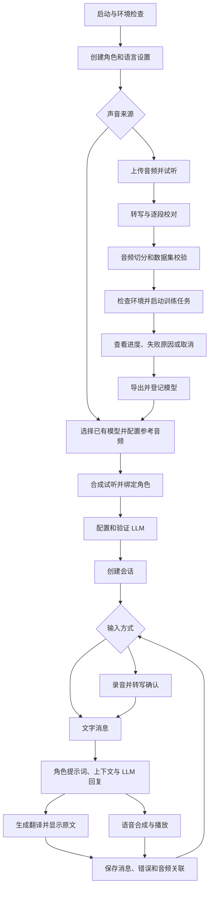

# VoiceRoleChat-Studio 完整开发流程与任务路线

更新时间：2026-10-25（Australia/Sydney）。这是产品路线与验收清单，不是全部功能已实现的声明。

## 产品目标与范围

交付 Windows 本地优先、单用户使用的 AI 角色语音工作室。用户可以创建角色、
导入已有声音模型，或从音频制作数据集并训练模型，再用文字或麦克风与角色对话，
查看原文和翻译并播放角色声音。保留现有 FastAPI、Whisper、GPT-SoVITS 和本地文件数据。

默认不加入多租户、支付、公开互联网托管或额外训练引擎。现有接口中的 CosyVoice
选项不代表该引擎已经可用；第一版只承诺完成 GPT-SoVITS。本地 LLM 优先，兼容接口
可作为可选提供方；需要用户提供的服务地址、凭据及音频偏好，在对应任务开始时确认。

## 用户完整流程

模型可导入时不必先训练。语音合成必须单独配置参考音频和对应文本/语言，
不能把发现一对权重等同于可推理。先完成按键录音和完整回复，再优化流式与打断。

## 初始审计基线（C2C-001，历史记录）

- C2C-001：已完成并获 ChatGPT 独立审查 PASS。
- Python 3.12、现有 GPT-SoVITS Conda Python 3.10 的基础测试各 5/5 通过。
- 实际 HTTP：health、角色列表、模型列表/详情/刷新、训练列表可访问。
- 当前有 2 组发现的配对模型和 1 组导出模型；尚未验证实际合成或训练重跑。
- 前端只有静态页面和按钮提示，尚未接业务接口。
- 角色只有创建/列表/详情；上传、转写、数据集构建和训练已有初步后端代码，
  不能将这些模块的存在计为完整产品验收。

详见 `docs/C2C-001-audit.md`。

后续已完成 C2C-002–008：模型管理、启动、服务管理、真实日语 CPU 合成、角色声音、
中文工作台与音频库均有独立审查和测试记录。C2C-009A 已通过真实离线 Whisper CPU
HTTP 转写，最终独立审查 PASS；完整 C2C-009 的任务生命周期和逐段编辑仍未实现。
最新功能、测试计数和使用限制以根目录 README 与各任务结果文档为准。

## 架构与数据边界

保留 FastAPI 为业务入口；第三方 GPT-SoVITS 通过隔离的本地进程/HTTP 适配器使用，
不在每次业务请求中重新导入训练环境。文件目录暂作为存储，增补版本化 JSON Schema、
原子写入与路径校验；确认文件方案不足后才评估数据库迁移。

角色、声音配置、模型、数据集、训练任务、会话、消息分别拥有稳定 ID。
角色引用声音配置，声音配置引用模型和参考音频；会话保存角色设置快照；
消息关联转写、回复、翻译和生成音频。修改角色不会覆盖已有会话历史。
训练和推理分别限制并发，模型切换与合成必须一致，避免串用其他角色权重。

## 分阶段任务与验收

每个编号是一个独立交付任务；实施前细化 API、Schema、文件范围和测试。
状态只有完成、进行中、待实施、待外部条件；测试替身通过不等于真实模型验收。

| 任务 | 功能与交付 | 依赖 | 必须验收 | 当前状态 |
|---|---|---|---|---|
| C2C-001 | 仓库基线、导入与 HTTP 启动审计 | 无 | 实际启动/API/资源保护与独立审查 | 完成 |
| C2C-002 | 模型 ID 冲突处理、导出 manifest 发现和去重 | 001 | 真实目录不重复；冲突不选错；坏 manifest 可诊断 | 完成，独立审查 PASS |
| C2C-003 | 环境配置、开发依赖与标准启动命令 | 001 | 根目录启动；缺依赖/缺路径提示；无隐式模型下载 | 完成，独立审查 PASS |
| C2C-004 | GPT-SoVITS 本地服务管理与可用性检测 | 002,003 | 检测未启动/超时；受控启停与自有进程清理 | 完成，独立审查 PASS；模型切换随 005 实现 |
| C2C-005 | 文本到声音最小 API、输出文件与试听 | 004 | 已有模型实际生成可播放 WAV；校验参考音频/语言；失败可恢复 | 完成，真实日语 CPU 与独立审查 PASS |
| C2C-006 | 角色编辑、声音绑定和配置版本兼容 | 002,005 | 创建/编辑/详情/列表；重启保留；旧角色迁移 | 完成，双环境回归及独立审查 PASS |
| C2C-007 | 前端基础工作台、角色与模型管理 | 003,006 | 真实 API 接入；加载/空/失败状态；模型试听与角色绑定 | 完成，浏览器、双环境及独立审查 PASS |
| C2C-008 | 音频库、上传校验、录音导入与试听 | 003 | 格式/体积/解码检查；非法音频拒绝；文件引用安全 | 完成，双环境/浏览器及独立审查 PASS |
| C2C-009 | Whisper 转写任务与逐段编辑 | 008 | 已有音频真实转写；保存更正；模型缺失明确提示 | 完成：009A/B/C 真实CPU、双环境、浏览器与独立审查 PASS |
| C2C-010 | 分段数据集构建、语言与质量检查 | 009 | 使用校对段落和对应切片；空段/时间重叠/无效分隔符处理 | 已完成；双环境167项、浏览器41项及真实音频验证，独立审查通过 |
| C2C-011 | 训练任务队列、进度、取消与失败恢复 | 003,010 | 不重复启动；子进程可终止；重启遗留状态可恢复 | 011A安全准备已完成并通过独立审查；011B队列/取消/快照待实施 |
| C2C-012 | 训练产物导出与注册闭环 | 002,011 | 短时真实 GPU 验证；产物可发现、可试听；失败无伪完成 | 待实施 |
| C2C-013 | LLM 提供方适配、配置和连接测试 | 003 | 本地提供方可用；超时/无服务/凭据错误；配置不泄露 | 待实施 |
| C2C-014 | 会话、消息持久化和文字角色聊天 | 006,013 | 角色提示词生效；上下文限额；重启恢复；取消无重复消息 | 待实施 |
| C2C-015 | 双语回复、原文/译文显示与情绪提示 | 014 | 原文不被翻译覆盖；翻译失败仍可读；语言设置与声音能力一致 | 待实施 |
| C2C-016 | 聊天回复合成、播放队列和音频关联 | 005,014 | 消息与声音对应；重试/自动播放失败处理；切换角色不串音 | 待实施 |
| C2C-017 | 按键录音→转写→确认→回复→播放 | 007,009,016 | 浏览器麦克风与失败提示；真实多轮语音聊天 | 待实施 |
| C2C-018 | 流式文本/声音、VAD 与播放打断 | 017 | 时间顺序正确；打断取消后续生成/播放；不播放旧轮回复 | 待实施 |
| C2C-019 | 完整声音工作台和训练前端 | 007,012 | 上传→校对→数据集→训练→试听全程 UI 完成 | 待实施 |
| C2C-020 | 系统中心、日志诊断和资源状态 | 003,011,013 | 可定位进程、模型、训练与服务故障；日志脱敏 | 待实施 |
| C2C-021 | 角色/声音配置导入导出与数据备份 | 006,014 | 备份可恢复；路径可迁移；不意外打包大权重/凭据 | 待实施 |
| C2C-022 | 跨模块端到端、边界和性能验证 | 017,019,020,021 | 真数据路径与临时夹具分离；离线故障恢复；记录硬件与延迟 | 待实施 |
| C2C-023 | Windows 启停脚本、首次引导与发布文档 | 022 | 新环境按照文档完成完整演示；退出无遗留任务；回滚路径明确 | 待实施 |

顺序可按依赖调整，不能跳过真实推理关口直接宣称声音工作室完成。

## 三个交付里程碑

**M1：声音能用。** 完成 002–007：已有模型可识别、配置参考音频、合成、试听、绑定角色，
并能在最小前端完成这些操作。真实 GPU/CPU 推理失败时先修适配与环境。

**M2：角色能聊。** 完成 013–017：文字与按键语音多轮聊天、双语文本、自动播放、会话持久化。
008–012 的声音训练链路与其按依赖交错推进，不阻塞已有模型聊天的早期验证。

**M3：工作室可发布。** 完成训练工作台、流式与打断、系统诊断、备份、完整测试与首次启动引导。
训练和推理最终验收均使用真实环境，保存可复现命令与结果。

## 每项任务的执行流程

1. 读取当前代码、用户新要求、上一轮审查和 Git 状态，保护未提交工作。
2. 固定单项设计/API/数据兼容约定，编写失败用例，再实施最小可交付变更。
3. 单元测试→API 测试→相关真实服务测试；前端任务补浏览器验收。
4. 记录命令、退出码、环境、未执行项、数据保留与剩余风险。
5. 通过当前 ChatGPT 项目发送 EXECUTED，由其读代码和输出独立审查。
6. 审查要求修复则仅修本项；通过后更新本文件状态并推进下一个依赖已满足的任务。

现有用户模型/训练数据不删除。完整训练、大模型下载和云服务支出不是日常单元测试步骤。
缺少用户凭据、需要登录或具体外部服务选择时，只暂停依赖该条件的任务。
后台长期推进或定时续跑需要另外明确安排；本文件本身不会创建后台任务。

## 初始模型管理边界（C2C-002 已完成）

C2C-002 拟保持现有非冲突短 ID；冲突时明确返回错误，不按扫描顺序静默选择。
导出 manifest 的权重必须是项目内可读文件；坏 JSON、缺失权重和重复来源分别处理。
通过 manifest 的来源路径与现有模型键关联并去重；不为用户修改/重写已有 manifest。
该边界已实施并验收；真实合成见 C2C-005，训练留到对应任务。
